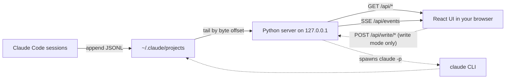

# Mission Control

**A local web UI that watches Claude Code work, live: chats, subagents, workflows and cost.**

Mission Control reads the transcripts Claude Code already writes under `~/.claude/projects` and turns them into a
browsable, live-updating dashboard. You get every conversation with its tool calls, git-style diffs of the files Claude
changed, a dashboard of each chat's agents and workflows, and an estimate of what it all cost. It is meant for people who
run several Claude Code sessions or long multi-agent workflows and want to see what is happening without tailing JSONL
files. Everything runs on your machine: the server binds to `127.0.0.1`, and the UI loads nothing from the network.


<!-- Screenshot placeholder: add one made from demo data only (start the server with MC_ROOT pointing at a scratch
     copy of synthetic transcripts). Never use real chats. -->

> Mission Control is an unofficial community project. It is not affiliated with or endorsed by Anthropic.

## Contents

- [Highlights](#highlights)
- [Quick start](#quick-start)
- [Configuration](#configuration)
- [How it works](#how-it-works)
- [Write mode and safety](#write-mode-and-safety)
- [Keyboard shortcuts](#keyboard-shortcuts)
- [Project structure](#project-structure)
- [Development](#development)
- [Troubleshooting](#troubleshooting)
- [Roadmap](#roadmap)
- [License](#license)

## Highlights

- **Chats sidebar.** Projects grouped by folder, with their chats. **Active now** at the top (anything that changed in
  the last 5 minutes), then **Starred** projects you pin and reorder, then the rest, newest first. Each row shows the
  title, time, message count, agent count and cost. Search with `⌘K`.
- **Conversation view.** User and assistant messages as markdown, collapsed thinking, every tool call with its input and
  a collapsible result, compaction and command notes. Older pages load as you scroll up; new lines stream in live.
- **Activity bar.** A vertical strip beside the conversation, one mark per entry of the whole chat (your prompts stand
  out). Hover for a quick preview, click to jump there; older parts load on demand.
- **Git-style diffs.** For any file a chat wrote: unified or split view, hunks with line gutters, "this change" or "all
  changes combined", and "Copy patch" that `git apply` accepts. Diffs are rebuilt from the transcript; your files are
  never read.
- **Mission Control dashboard.** Per chat: each workflow or plain agent is a run, with stat tiles, phase rings, agent
  cards with live elapsed time and activity sparklines, a live feed, deliverables, a run switcher and a detail drawer
  with the cost table and timeline.
- **Agents home page.** Every agent across all chats: running now, and recently finished (last 24 h) with the first
  line of each final report.
- **Agent Tasks menu.** A chat's subagents and workflows as tasks, with status, agent count, tokens and cost; jump to
  any agent's own transcript.
- **Honest status.** A chat whose last turn was interrupted, or an agent you stopped, shows as **stopped**, not running.
- **Cost and tokens.** Today's cost and tokens across every chat and agent, in the top bar; per chat, the conversation
  itself, its agents and the total.
- **Live sync.** Server-Sent Events push changes as files grow; only the changed chats are refetched.
- **Optional write mode.** Off by default. Start a new chat or send a message from the browser, with strict guards
  (see [Write mode and safety](#write-mode-and-safety)).
- **Themes.** Light, Dark and Dim, with WCAG AA contrast and `prefers-reduced-motion` respected.

## Quick start

**Requirements**

- macOS or Linux (write mode uses POSIX process groups; Windows is not supported)
- Python 3.9 or newer (standard library only, no `pip install`)
- Node.js 20 or newer, and npm
- [Claude Code](https://docs.anthropic.com/en/docs/claude-code) installed, with some sessions under `~/.claude/projects`

**Install and run**

```bash
git clone https://github.com/nicobar97/cc_agentic_mission_control.git
cd cc_agentic_mission_control
npm install
npm start
```

`npm start` builds the UI into `dist/` and serves it, together with the API, at
**<http://127.0.0.1:8765>**. Press `Ctrl-C` to stop it.

**Other scripts**

| Command         | What it does                                                                                   |
| --------------- | ---------------------------------------------------------------------------------------------- |
| `npm start`     | Build the UI, then serve it and the API on port 8765                                           |
| `npm run serve` | Serve the last build without rebuilding                                                        |
| `npm run dev`   | API on `:8765` plus Vite with hot reload on <http://127.0.0.1:5173> (proxies `/api`)           |
| `npm run build` | Type-check (`tsc --noEmit`) and build into `dist/`                                             |

`Ctrl-C` stops `npm run dev` too; it only stops the processes it started itself.

To keep the server running in the background:

```bash
PYTHONDONTWRITEBYTECODE=1 nohup python3 -B server/server.py --port 8765 --static dist > run.log 2>&1 &
echo $! > server.pid
kill "$(cat server.pid)"   # stop
```

`run.log` and `*.pid` are ignored by git.

## Configuration

Environment variables:

| Variable         | Default                                 | Read by                     | Purpose                                                              |
| ---------------- | --------------------------------------- | --------------------------- | -------------------------------------------------------------------- |
| `PORT`           | `8765`                                  | `server/server.py`          | Server port for `npm start` / `npm run serve` (`PORT=9000 npm start`) |
| `MC_API_PORT`    | `8765`                                  | `scripts/dev.mjs`, Vite     | API port in `npm run dev`                                            |
| `MC_DEV_PORT`    | `5173`                                  | `scripts/dev.mjs`, Vite     | Vite dev server port                                                 |
| `MC_ROOT`        | `~/.claude/projects`                    | `server/store.py`           | Read transcripts from another folder, such as a scratch or demo copy |
| `MC_PATH_PREFIX` | `~/`                                    | `server/tracker_port.py`    | Path prefix trimmed from tool inputs in the activity feed            |
| `MC_CLAUDE_BIN`  | `claude` on `PATH`, else `~/.local/bin/claude` | `server/runner.py`   | The Claude Code binary write mode starts                             |

`PORT` does not affect `npm run dev`; use `MC_API_PORT` there. All `MC_*` variables are removed from the environment
of any `claude` process that write mode starts.

Server flags (`python3 -B server/server.py ...`):

| Flag                | Default | Purpose                                                        |
| ------------------- | ------- | -------------------------------------------------------------- |
| `--port`            | `8765`  | Port (falls back to `PORT`)                                    |
| `--static DIR`      | none    | Serve the built UI from `DIR` (usually `dist`)                 |
| `--interval SECS`   | `1.5`   | How often the watcher checks the transcript files              |
| `--verbose`         | off     | Log every HTTP request                                         |
| `--dev-origin URL`  | none    | Extra Origin allowed to write (the Vite dev server); repeatable |

## How it works



- **Data source.** The server indexes every transcript under `~/.claude/projects`, including subagent and workflow
  transcripts. Each file is tailed by byte offset, so a growing chat costs only its new lines. A file that shrinks or
  changes inode is re-read from the start.
- **Live updates.** A watcher thread checks the files every 1.5 s and pushes a `change` Server-Sent Event naming the
  chats that changed. The UI refetches only those, and skips redrawing when nothing differs.
- **Agent status.** Runs, phases, the feed and done / stopped rules come from a port of an earlier tracker script:
  an agent is done on a result, a finish marker or a hand-back; it is stopped when its turn was interrupted or it was
  killed, and a run with no activity for 45 minutes counts as stopped.
- **Cost estimation.** Usage is deduplicated per message id across all files and priced per model at list API prices
  (input, output, 5-minute and 1-hour cache writes, cache reads; fast mode at 2x). It is an estimate: a subscription
  plan bills differently.
- **Diffs** are rebuilt from the `Write` / `Edit` tool inputs and results recorded in the transcripts.
- **Stack.** The server is Python standard library only. The UI is React 18, TypeScript and Vite, with `marked` for
  markdown, bundled locally with no CDN at runtime.

Useful URL options: `?static=1` loads once without live updates, and `?theme=light|dark|dim` picks a theme. Chats have
deep links such as `#/s/<project-slug>/<session-id>`, `...?tab=mc&run=<run-id>` and `.../a/<agent-id>`.

## Write mode and safety

Mission Control is read-only unless you turn write mode on.

**Read side**

- The server binds to `127.0.0.1` only. The `Host` header must be `127.0.0.1` or `localhost`, which blocks DNS
  rebinding. There are no CORS headers.
- Reads are `GET` / `HEAD`. The only accepted `POST` is `/api/write/*`; any other method gets `405`.
- Ids in API calls are looked up in the index, never joined into paths, and every read stays under `~/.claude/projects`.
- Mission Control itself never writes, moves or deletes anything under `~/.claude`. It runs Python with `-B` so no
  `__pycache__` is created. In write mode, only the `claude` CLI it starts writes there, as it always does.

**Write mode** is **off by default**. Toggle **Write mode** in the top bar; it lasts for the current browser tab only,
and new tabs start read-only. It adds a composer under each chat and a **New chat** button (working directory, model,
permission mode, first prompt). A panel streams the run and offers **Stop**.

Every write request is checked by the server:

- **Per-launch token.** A random token is created at startup, kept in memory only, injected into the served page and
  required in the `X-MC-Token` header. It never goes into a cookie, a URL or the logs. A restart makes old tabs stale.
- **Origin check.** The `Origin` header must be the app's own origin (or the Vite dev origin given with `--dev-origin`).
- **Allowed permission modes only:** `default`, `acceptEdits` and `plan`. `bypassPermissions`, `dontAsk`, `auto` and
  anything containing "dangerously" are refused. Runs use `--permission-prompts none`, so anything that would ask for
  approval is denied. Your own `settings.json` allow and deny rules still apply.
- **No shell, prompt on stdin.** `claude` is started with an argument list. The prompt is written to stdin, so it can't
  be parsed as a flag and doesn't appear in `ps`.
- **Working directory limits.** It must be an absolute, existing folder inside your home, with no `..`. Symlinks are
  resolved, and `~/.claude`, other top-level dot-folders and `~/Library` are refused.
- **Live chats are forked, never written into.** If a chat changed in the last 2 minutes and Mission Control isn't the
  one writing it (an open terminal session, for example), sending is refused and **Fork into a new chat** is offered
  instead (`--resume <session-id> --fork-session`).
- **Concurrency caps.** One run per chat and at most 3 runs at once. Request bodies are capped at 256 KB.
- **Clean environment.** The spawned `claude` inherits your environment minus `MC_*` and the variables that tie a process
  to a parent Claude Code session.
- **Prompts are never logged.** Logs hold metadata only: run id, session id, working directory, mode, model, exit code.

> [!WARNING]
> **Claude Code deletes old transcripts.** Every time `claude` starts, interactive or headless (including runs started
> by Mission Control), it applies its own `cleanupPeriodDays` setting (default **30 days**) and deletes older
> transcripts under `~/.claude/projects`. Mission Control can't show what has been deleted. To keep history longer,
> raise it in `~/.claude/settings.json`:
>
> ```json
> {
>   "cleanupPeriodDays": 365
> }
> ```

## Keyboard shortcuts

| Key                  | Where                          | Action                                         |
| -------------------- | ------------------------------ | ---------------------------------------------- |
| `⌘K` / `Ctrl+K`      | Anywhere                       | Focus the chat search                          |
| `/`                  | Mission Control, Home          | Search agents                                  |
| `r`                  | Mission Control                | Open or close the run switcher                 |
| `t`                  | Anywhere                       | Cycle the theme (Light, Dark, Dim)             |
| `j` / `k`            | Diff viewer                    | Next / previous change                         |
| `Esc`                | Drawer, menus, diff, search    | Close, or leave the search field               |
| `Alt+↑` / `Alt+↓`    | A focused starred project      | Move it up or down                             |
| `Enter`              | Composer                       | Send                                           |
| `Shift+Enter`        | Composer                       | New line                                       |

## Project structure

```text
server/
  server.py        HTTP server: guards, API routes, Server-Sent Events, static bundle
  store.py         Incremental index of ~/.claude/projects, active chats, today's totals, agent links
  transcript.py    Turns JSONL lines into conversation entries, paged from the end
  tracker_port.py  Run and agent status rules, phases, feed and pricing
  diffs.py         Rebuilds git-style diffs from Write/Edit tool calls
  runner.py        Write mode: safety checks and the headless claude runs
scripts/
  dev.mjs          `npm run dev`: starts (or reuses) the API, then Vite
src/
  main.tsx, App.tsx  App shell, top bar, chat view, Agent Tasks menu
  lib.ts           Types, API client, hash routing, live sync, formatting
  components/      Sidebar, Transcript, MissionControl, Home, Diff, Write, shared bits
  theme.css        Design tokens for the three themes
  app.css, tracker.css, refine.css  Layout, dashboard and design-pass styles
```

## Development

```bash
npm install
npm run dev          # API + Vite with hot reload on http://127.0.0.1:5173
npx tsc --noEmit     # type-check only
npm run build        # type-check and build into dist/
```

There is no formatter, linter or test suite configured yet; match the style of the surrounding code. The server must
stay standard-library Python and must never write under `~/.claude`. To add a feature, add or extend a `GET` route in
`server/server.py` (with the data work in `store.py`, `transcript.py` or `tracker_port.py`), add its type and fetch in
`src/lib.ts`, and render it in a component under `src/components/`, using the tokens in `src/theme.css` rather than
new colours. Anything that writes must go through `POST /api/write/*` and `server/runner.py`.

## Troubleshooting

- **Port already in use.** Pick another port: `PORT=9000 npm start`. In dev, Vite refuses to move off its port
  (`strictPort`), so set `MC_DEV_PORT`. If an API already answers on `MC_API_PORT`, `npm run dev` reuses it.
- **Write mode fails in dev with "forbidden origin".** The reused API was not started with
  `--dev-origin http://127.0.0.1:5173`. Stop it and run `npm run dev` again so it starts its own.
- **"missing or wrong write token" (403) after a restart.** The token changes on every launch. Reload the tab.
- **Headless screenshots never finish.** The open event stream keeps headless Chrome's `--virtual-time-budget` from
  expiring. Add `?static=1` to the URL.
- **Big transcripts.** The conversation loads the last 150 entries and fetches older ones as you scroll up. Long tool
  outputs are shortened on the server; use **Show all** for the full block. The first index of a large
  `~/.claude/projects` can take a few seconds; the server prints how long it took.
- **An agent link is disabled.** The ⓘ next to it gives the reason: a rejected call, an agent not written yet, or a
  transcript removed by Claude Code's cleanup (see the warning above).

## Roadmap

- A "working" indicator in the chat view
- A trash bin for chats
- Screenshots made from demo data
- Tests and CI for the server's parsing and safety rules

## License

License: not yet chosen.
